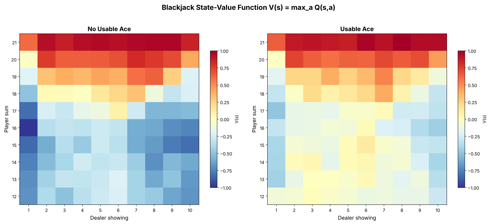

# Reinforcement Learning Agents for Blackjack

Two model-free reinforcement learning agents, **Q-learning** and **Monte Carlo control**, that learn to play Blackjack in the [RLCard](https://github.com/datamllab/rlcard) environment, plus a terminal interface where a human can play against or alongside the trained agents.

> Team project built in October 2025 ([original team repository](https://github.com/AronKG/RL_project)). Updated in November 2026 with tests, CI, a minimal dependency list and this README.

## Results

Win rates against the dealer (the rest are losses and pushes), measured in the same RLCard environment:

| Policy | Win rate | Games |
|---|---|---|
| Random actions | 28.5% | 100,000 |
| Always stand | 38.3% | 100,000 |
| Simple rule: hit below 17 | 40.8% | 100,000 |
| **Q-learning agent** | **41.9%** | 100,000 |
| **Monte Carlo agent** | **43.1%** | 50,000 |

Both agents learn strategies that beat the simple baselines. The Monte Carlo agent also tracks whether the player holds a *usable ace* (soft hands), which the Q-learning agent's state does not include.



*Learned state values V(s) = max<sub>a</sub> Q(s, a) for the Monte Carlo agent. Red means the player is likely to win from that state; blue means likely to lose. A usable ace makes low player sums much safer.*

## How the agents learn

The environment gives the agent its hand total and the dealer's visible card (the dealer's hole card stays hidden). Actions are **hit (0)** and **stand (1)**. The reward is +1 for a win, 0 for a push and −1 for a loss, given at the end of the game.

### Q-learning (`q_learning.py`)

Temporal-difference learning with an ε-greedy policy:

```
Q(s, a) ← Q(s, a) + α · [ r + γ · max_a' Q(s', a') − Q(s, a) ]
```

- State: (player sum, dealer card), 180 states
- Learning rate α = 0.1, discount γ = 0.95
- Exploration ε starts at 1.0 and decays by 0.9995 per episode down to 0.01

### Monte Carlo control (`mc.py`)

Plays a full episode, then updates every visited (state, action) pair towards the return G of that episode:

```
G_t = r_{t+1} + γ · G_{t+1}        Q(s, a) ← Q(s, a) + α · [ G_t − Q(s, a) ]
```

- State: (player sum, dealer card, usable ace)
- First-visit updates, constant step size α = 0.01, discount γ = 1.0 and ε = 0.1 (command-line defaults)
- Includes a hyperparameter sweep (α, γ, ε) and state-value heatmaps

## My contributions

- Implemented the **Monte Carlo agent**: first-visit MC control with ε-greedy exploration, hand-value and usable-ace logic, training statistics, **state-value heatmaps** and the **hyperparameter sweep** (originally `ai_training.py` in the team repository, later moved into `mc.py`)
- Tuned the learning rate (α) of the trained model
- Built a **terminal game mode**, a **web version** and a **multi-agent test** in the team repository
- Wrote the first project description, `requirements.txt` and `.gitignore`
- 2026: tests, CI, dependency clean-up and this README in this repository

Q-learning, DQN experiments and the final interactive interface were built by teammates; see the [team repository history](https://github.com/AronKG/RL_project/commits) for details.

## Getting started

Requirements: Python 3.11+

```bash
git clone https://github.com/ParnaSaeidpour/RL-agents.git
cd RL-agents
python -m venv .venv && source .venv/bin/activate
pip install -r requirements.txt
```

### Run with Make

```bash
make all      # train both agents, then open the interface
make train    # train only
make play     # play against the agents (untrained agents also work)
```

### Run with Python

```bash
python analysis.py                          # train + evaluate the Q-learning agent
python mc.py --episodes 200000              # train + evaluate the Monte Carlo agent
python mc.py --grid-search                  # hyperparameter sweep
python interface.py                         # play in the terminal
```

Trained models are saved in `models/`, results in `results/` and charts in `visualizations/` (all git-ignored).

## Tests

```bash
pip install -r requirements-dev.txt
pytest
```

- `tests/test_q_learning.py`: the Q-learning update rule, exploration decay, state handling, saving/loading, and a short training run that beats random play
- `tests/test_monte_carlo.py`: hand values and usable aces, discounted returns, first-visit updates and policy extraction
- `tests/test_environment.py`: action ids match RLCard and the dealer's hole card is hidden
- `tests/test_analysis.py`: evaluation logs the right action names and records final scores and busts

GitHub Actions runs the tests on every push and pull request.

## Project structure

```
fix_env.py       # BlackjackEnvironment wrapper around RLCard; HIT / STAND action ids
q_learning.py    # Q-learning agent, training and evaluation
analysis.py      # trains the Q-learning agent and writes statistics and charts
mc.py            # Monte Carlo agent, heatmaps and hyperparameter sweep
interface.py     # play against / with the trained agents in the terminal
tests/           # pytest tests
```

## Team

- Aron Kesete
- Isac Gustafsson
- Parna Saeidpour
